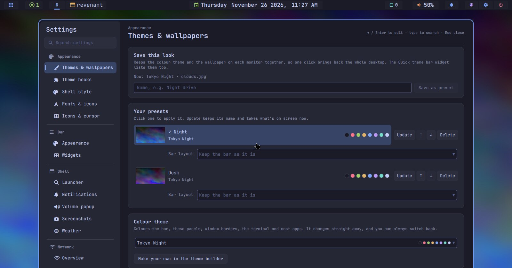
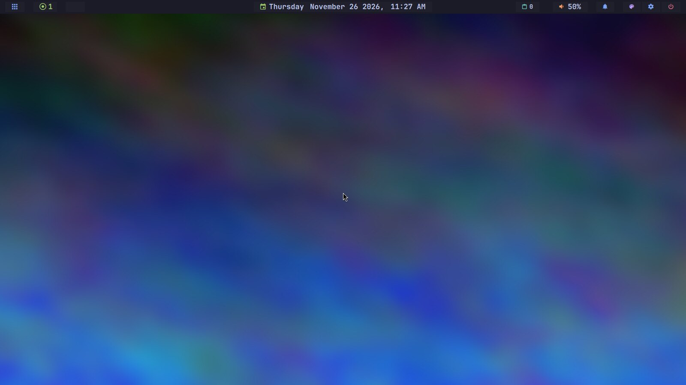
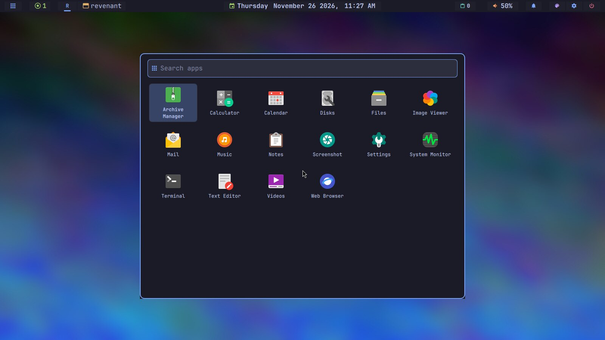

# Revenant

A [Quickshell](https://quickshell.outfoxxed.me/) (QML) desktop shell for **i3
on X11**, for people going back to X11 and i3. It replaces polybar, dunst and
rofi:

- a bar per monitor (per-monitor layouts and presets, four widget styles,
  ~35 widgets)
- a Control Center: Wi-Fi, Bluetooth, Do Not Disturb and mute toggles,
  volume, media, and Network (with a traffic graph) / Bluetooth /
  Notifications / Updates sections
- notifications with history, and an on-screen display for volume
- a clipboard panel: text (clipmenu), copied images and emoji, one popup
- Flameshot-style screenshots: freeze the screen, pick a window, monitor or
  area, draw arrows and boxes, then copy or save
- an app launcher, Alt+Tab window switcher, power menu, Task Manager,
  keybind cheat sheet and notepad
- a Settings window that also edits your i3 keybinds, window options and
  monitor layout (each change checked with `i3 -C`), autostart, default apps,
  Wi-Fi, Bluetooth, polkit prompts, and the theme of i3, kitty, GTK and Qt



| | |
|---|---|
|  |  |

<sub>Screenshots come from `scripts/dev/screenshots.sh [theme]`, which runs the
shell in a throwaway nested desktop.</sub>

**Coding agents:** read [AGENTS.md](AGENTS.md) — how to change the bar, write
widgets and theme hooks, and drive the shell over IPC. The shell copies it to
`~/.config/revenant/AGENTS.md` at start, so agents working there find it too.
Claude Code reads `CLAUDE.md` rather than `AGENTS.md`: the shell's `CLAUDE.md`
imports it, and so does the one created in `~/.config/revenant/`.

There's no compositor: every window is opaque and square (see *X11 rules*).
The window-manager seam is `services/I3.qml`: a long-lived
`i3-msg -t subscribe` in, `get_workspaces` / `get_tree` / `get_outputs` to
refresh, and `i3-msg` commands out.

## Requirements

- **Quickshell ≥ 0.3** (with X11 and I3 support), **i3 ≥ 4.20**, Python 3
- **NetworkManager** (Wi-Fi, connections) and **PipeWire** (volume, OSD,
  visualiser), **BlueZ** for Bluetooth
- **clipmenu 7** (`clipmenud`) for text history
- `xclip`, `xdotool`, `maim`, ImageMagick, `xwallpaper`, `jq`,
  `xset` / `xrandr`, `notify-send`, `xdg-open`
- Python modules: python-xlib, PyGObject (`gi`)
- a **Nerd Font** (bar icons) and **Noto Color Emoji**; an icon theme for
  tray icons (see below)

| | Packages (names differ a little between releases) |
|---|---|
| Debian / Ubuntu | `quickshell` (Debian 13: from `trixie-backports`), `clipmenu` (not packaged: build from [source](https://github.com/cdown/clipmenu)), `i3 xclip xdotool maim imagemagick xwallpaper jq x11-xserver-utils libnotify-bin xdg-utils network-manager pipewire-pulse python3-xlib python3-gi fonts-noto-color-emoji qml6-module-qt-labs-folderlistmodel qml6-module-qtquick-effects` |
| Arch | `quickshell` (AUR), `i3-wm clipmenu xclip xdotool maim imagemagick xwallpaper jq xorg-xset xorg-xrandr libnotify xdg-utils networkmanager pipewire-pulse python-xlib python-gobject noto-fonts-emoji` |
| Fedora | `quickshell` (COPR), `i3 clipmenu xclip xdotool maim ImageMagick xwallpaper jq xset xrandr libnotify xdg-utils NetworkManager pipewire-pulseaudio python3-xlib python3-gobject google-noto-color-emoji-fonts` |

Optional — each feature hides or says what's missing without them:
`cava` (audio visualiser), `brightnessctl`, `power-profiles-daemon`,
`headsetcontrol`, `dex` (XDG autostart), `flatpak` / `snap` (update counts),
a polkit agent such as polkit-gnome or lxpolkit (when the shell isn't the
agent), kitty (themed whenever it is installed).

## Install

```sh
git clone @REPO_URL@ ~/Projects/revenant
~/Projects/revenant/install.sh          # --dry-run first to see what it would do
```

> [!WARNING]
> **Debian 13 (trixie): the installer enables `trixie-backports`.** Quickshell
> is only packaged there, so it adds
> `/etc/apt/sources.list.d/trixie-backports.list` (after asking). Backports
> never replace a package on their own, but the install takes the
> packages it asks for from backports where they're newer, so PipeWire
> comes from backports too (Quickshell needs its newer library). Answer
> *no* to keep backports off; the shell can't be installed from
> packages then. To undo it later, delete that file and run `sudo apt update`.

`install.sh` asks before each step, and running it again changes nothing:
1. packages, with `sudo`. On Debian/Ubuntu it sets up a fresh system
   completely: it enables Debian's backports (Quickshell is only there on
   Debian 13), runs `apt-get update` and installs the shell's packages plus
   sound, network, Bluetooth, fonts, Papirus icons, kitty, qt5ct/qt6ct and
   xsettingsd (and an X server and LightDM if there are none). It also
   builds clipmenu 7 and downloads the adw-gtk3 GTK theme, which neither
   distro packages. On Arch and Fedora it installs the table above.
2. a copy of the clone in `~/.config/quickshell/revenant`, where the shell
   runs from (to update: `git pull` in the clone, then `install.sh` again;
   clone straight into `~/.config/quickshell/revenant` and `git pull` alone
   is enough)
3. i3: with no config yet (or only the one i3-config-wizard wrote), a
   starter config from `i3/starter/` with the shell's keys, gaps and colours,
   laid out the way Settings → Keybinds and i3 Options edit it. With your
   own config, the i3 lines below at its end between marker lines. Either
   way it keeps a backup, and puts it back if `i3 -C` rejects the result.
   `--i3-starter` swaps your config for the starter one.
4. `QS_ICON_THEME` and `QT_QPA_PLATFORMTHEME`, added to `~/.xsessionrc` on
   Debian/Ubuntu (their login session reads it) or `~/.xprofile`, unless
   your session files set them already
5. the current theme (Dracula on a new install) applied once through the
   theme hooks, so i3, kitty, GTK and Qt match from the first login

It only points out polybar, dunst or an i3bar `bar { }` block; remove those
yourself. `--yes` skips the questions, `--no-packages` the package step. A
setup you made by hand is recognised and left alone.

### By hand

```sh
git clone @REPO_URL@ ~/.config/quickshell/revenant
```

The directory name matters: panel window titles, runtime files and the config
directory are named after it. Then, in your i3 config:

```
# Window rules, and $rev / $rev_shot for your own binds (after your colours):
include ~/.config/quickshell/revenant/i3/revenant.config
# Optional default shortcuts (Super+D launcher, Super+V clipboard, Print, …):
include ~/.config/quickshell/revenant/i3/revenant-keys.config
# Theme colours for i3 windows, written by the theme switch:
include ~/.config/revenant/i3-colors.config

exec --no-startup-id qs -c revenant
```

Nothing goes in a login file: when the shell starts it applies key repeat,
screen blanking, power saving and your wallpaper itself, as a desktop's
settings daemon would, and sets the login volume (off unless you turn it on
in Settings → Autostart) once per session. Restarting the shell is safe:
it re-applies the same values and leaves your volume alone.

Two optional variables do have to come from your session environment
(`~/.profile`, `~/.xprofile` or your display manager's equivalent):

```sh
export QS_ICON_THEME=Papirus-Dark   # any installed icon theme, for tray icons
export QT_QPA_PLATFORMTHEME=qt5ct   # if you want Qt apps themed
```

If you want the session settings in place before i3 draws anything, you can
also run `~/.config/quickshell/revenant/scripts/system/session.py login`
from a login script; the shell then doesn't set the volume a second time.

Keybinds and Windows & gaps in Settings edit `modules/keys.config` and
`modules/window-options.config` next to your i3 config; if your config has
no such modules, the page offers **Set up**, which creates them and adds the
include lines (checked with `i3 -C`).

## Files

| Where | What |
|---|---|
| `~/.config/quickshell/revenant/` | the shell; it never writes here |
| `~/.config/revenant/` | your settings: `settings.json`, `session.env`, themes made in the builder (`themes/`), theme hooks (`hooks/theme.d/`), your widgets (`widgets/`), the generated `i3-colors.config` and a copy of `AGENTS.md` (your notes for agents: `AGENTS.local.md`; a `CLAUDE.md` importing both is created once for Claude Code) |
| `~/.local/state/revenant/` | the active theme, wallpaper, notepad, saved monitor layout |
| `$XDG_RUNTIME_DIR/revenant-*` | screenshots in progress, copied-image history (in RAM, gone at logout) |

`XDG_CONFIG_HOME` and `XDG_STATE_HOME` are honoured.

## What it writes outside its own directory

| Settings page | Writes | How |
|---|---|---|
| Themes & wallpapers | `i3-colors.config`, kitty, GTK, Qt, rofi, your hooks | `scripts/theming/apply-theme-externals.sh` (see *Theming*) |
| Keybinds | i3 `modules/keys/*.config` | `scripts/i3/i3-key-editor.py` |
| Windows & gaps | i3 `modules/window-options.config` | `scripts/i3/i3-window-options.py` |
| Monitors | xrandr now; `monitors.json` in the state dir for later sessions | `scripts/i3/monitor-layout.py` |
| Default apps | your XDG MIME associations | `scripts/system/default-apps.py` |
| Network → Saved networks | NetworkManager profiles (connect, auto-connect, delete; may ask via polkit) | `scripts/system/network.py` (nmcli) |
| Autostart | `~/.config/autostart/*.desktop` (run at login by `dex --autostart`); `exec` lines in the i3 config (checked with `i3 -C`, no reload); `systemctl --user` enable/disable/start/stop | `scripts/system/autostart.py` |
| Keyboard, Screen & power, Autostart ▸ At login | `session.env` in the config dir, applied now with `xset`, and by the shell at every start (`session.py start`; the login volume once per session) |

Settings → Password prompts makes the shell the session's polkit agent
(`services/Polkit.qml` + `panels/PolkitPanel.qml`). `scripts/system/polkit-agent.sh`
stops the system's own agent first (polkit-gnome, lxpolkit, …) and starts it
again when you switch back.

The i3 editors share `scripts/i3/i3_config.py`: they find their module among
the files the running i3 includes, take a lock, check the staged result with
`i3 -C`, write atomically, and put the original back if `i3-msg reload`
fails. A monitor change reverts itself after 15 s unless you keep it; a
detached watchdog enforces that, so closing Settings mid-countdown still
reverts. The saved layout is restored when the shell starts (`shell.qml`).

## X11 rules (no compositor)

- **Window types.** Only the bar is a `PanelWindow` (i3 docks it). Dropdowns
  and toasts are `PopupWindow`s (override-redirect, mouse-only). Keyboard
  panels are `FloatingWindow`s; Quickshell sets no WM_CLASS, so
  `i3/revenant.config` matches their title, `revenant` (`revenant-shot` for the
  screenshot selector).
- **No alpha.** Every window is opaque and square. Fades, item opacity and
  rounded shapes *inside* a window are fine: Qt blends those itself.
- **Panels fit their content through i3.** A keyboard panel is sized from its
  `OverlaySurface`, but i3 keeps a floating window's size once mapped and
  ignores the window's own resizes, so `OverlayPanel` sends i3
  `resize set W H, move position center` when the content changes while open
  (batched over 30 ms). Don't animate a surface's size: that is an i3 command
  per frame.
- **Closing.** i3 runs `focus_follows_mouse no`: a panel closes when it loses
  focus (you clicked elsewhere). Dropdowns can't get focus, and
  `PopupWindow.grabFocus` only grabs on Wayland, so while one is open
  `scripts/system/click-watch.py` reports every button press (XInput2 raw events,
  which don't consume the click) and a press outside the popup closes it.

## Keybinds

Panels are toggled over IPC: `qs -c revenant ipc call shell <name>` (`$rev <name>`
from `i3/revenant.config`; the defaults are in `i3/revenant-keys.config`, and
Settings → Keybinds edits your own).

| Key | IPC |
|---|---|
| Mod+D | `launcher` |
| Mod+S | `settings` |
| Mod+Shift+T | `themes` (Settings → Themes & wallpapers) |
| Mod+Ctrl+W | `wallpaper` (Settings → Themes & wallpapers → Wallpapers) |
| Mod+Shift+W | `weather` (dropdown on the focused screen) |
| Mod+V | `clipboard` (Text section) |
| Mod+Shift+V | `clipimages` (Images section) |
| Mod+E | `emoji` (Emoji section) |
| Mod+/ | `keybinds` |
| Ctrl+Shift+Escape | `processes` (Task Manager) |
| Alt+Tab | `windowswitcher` |
| Ctrl+Mod+BackSpace | `powermenu` |
| Print / Shift+Print / Mod+Print / Mod+Shift+Print | `scripts/screenshot/screenshot-capture.sh region / window / screen / menu` |

`notepad` and `screenshot` (a region capture) are also available over IPC.

Control Center (`panels/ControlCenter.qml`, one per bar): Wi-Fi, Bluetooth,
Do Not Disturb and Mute tiles (the Wi-Fi and Bluetooth tiles' › open their
section), volume, media, and Network · Bluetooth · Notifications · Updates
sections. The `controlCenter` bar widget shows the indicators its options
pick and opens it (`openOn`: last section or a fixed one); right-click
toggles Do Not Disturb. It replaced the separate Wi-Fi, Bluetooth and Updates
widgets; the section bodies are `components/NetworkSection`,
`BluetoothSection`, `UpdatesSection` and `NotificationsSection`. The
`notifications` widget keeps a notifications-only dropdown (same list, plus
Do Not Disturb and Clear all).

Clipboard: one panel (`panels/ClipboardPanel.qml`) with Text, Images and
Emoji sections under one search field. Each bind opens its own section,
switches to it if the panel is up on another, or closes it if it is already
showing; Tab / Shift+Tab and Ctrl+1–3 switch inside. clipmenu 7 keeps text
only, so `scripts/clipboard/clip-image-watch.py` (started by `services/ClipImages.qml`)
keeps the images; a re-copied image moves to the front instead of being
stored twice. Text entries that aren't valid UTF-8 are hidden: those are
images clipmenud stored as text (xclip answers its text request with the
image bytes).

Screenshots: Print freezes every monitor as a BMP in `$XDG_RUNTIME_DIR` and
opens `panels/ScreenshotSelector.qml`, one window spanning all outputs
(`fullscreen enable global`, rule in `i3/revenant.config`). Click a
window or monitor, or drag an area; drag the handles to adjust; draw with
pen / arrow / rectangle / highlighter (V P A R M, colours 1–5, Ctrl+Z). Enter or
Ctrl+C copies, Ctrl+S saves (folder, date-time name format and an optional
name prompt in Settings → Screenshots), Shift+Enter does both,
Ctrl+O saves and opens; Esc cancels, right-click reselects. Only the
selection is exported (`grabToImage`), and the PNG encode runs afterwards in
`screenshot-deliver.sh`, detached.
The theme picker and builder opens from Settings → Themes & wallpapers → Colours.

## The bar

Widgets are configured from **Settings → Bar → Widgets**: drag to reorder
within and between left/center/right, and open a widget to edit its options.
**Bar → Appearance** picks the widget style (`polybar` | `pills` | `segments`
| `flat`, applied in `components/BarSection.qml` with the rules in
`components/BarStyle.js`). With the layout mode set to separate, each monitor
gets its own profile (`bar.monitorProfiles`); layouts can be saved as presets.

Adding a widget type is two edits:

1. `widgets/<Name>.qml`, usually a `Components.BarWidget`. Read per-instance
   options as `instance.<key> ?? fallback`, with the same fallback as its
   option row.
2. `services/WidgetCatalog.qml`: one entry with its type, name, icon, file and
   options. TopBar loads the file, Settings → Bar lists and edits it, and
   `Settings.normalizeWidget()` keeps exactly the option keys it declares.
   `check-architecture.sh` fails if an entry's file is missing or a widget
   file has no entry.

### Your own widgets

Widgets that aren't part of the shell live in `~/.config/revenant/widgets/<id>/`:
a `widget.json` (name, icon, description, option rows in the catalog's schema)
and a `Widget.qml` that imports the shell as `qs.services`, `qs.components.bar`,
`qs.lib` — the same live objects, so it themes like a built-in. They join the
catalog as type `user:<id>` (`scripts/system/user-widgets.py` lists them;
`services/WidgetCatalog.qml` merges them), show up in Settings → Bar → Widgets
marked "yours", and reload on save; a `user:*` entry on the bar that the catalog hasn't seen yet makes it look again. `scripts/dev/check-widget.sh <folder>`
checks one; `examples/widgets/hello/` is a template. Details in
[AGENTS.md](AGENTS.md).

## Settings window

`panels/SettingsWindow.qml`, with the sidebar defined as data in
`services/SettingsTabs.qml` and one file per page in `panels/settings/pages/`.
The sidebar groups the pages: Appearance, Bar, Shell (launcher, notifications,
OSD, screenshots, weather), Network, Devices (Bluetooth, monitors, keyboard),
Window manager (keybinds, i3 options), System (screen & power, systemd, autostart,
default apps, updates, admin prompts), then About.
Every page is a `SettingsUi.SettingsPage`, which gives it the keyboard row
cursor (`check-architecture.sh` enforces this). Bar → Widgets is
`panels/settings/pages/BarWidgetsPage.qml`, which drives `KeyNavCursor` itself.

## Theming

Themes are JSON files in [`themes/`](themes/); build your own in the theme
picker (**+ New theme**), which saves to `~/.config/revenant/themes/` (a
name that matches a shipped theme gets a suffix, so shipped files are never
overwritten). The active slug is in the state dir's `current`;
`services/Colors.qml` watches it and recolours the shell live.

On every apply, `scripts/theming/apply-theme-externals.sh <slug>` loads the
palette and runs the **theme hooks** through `scripts/theming/theme-hooks.py`:

- built-in, in `scripts/theming/hooks/`: `10-i3` (`~/.config/revenant/i3-colors.config`,
  reloading i3 if your config includes it), `20-rofi` (`colors.rasi`, only one
  it wrote), `30-kitty` (`current-theme.conf` — include it at the end of
  `kitty.conf`), `40-gtk` (GTK 3 live through a generated theme and
  xsettingsd; GTK 4 `gtk.css`), `50-qt` (qt5ct/qt6ct palettes, Fusion),
  `60-kde` (`plasma-apply-colorscheme`, if installed);
- yours: every executable in `~/.config/revenant/hooks/theme.d/`, called with
  `NAME BG FG COMMENT SELECTION RED GREEN YELLOW BLUE MAUVE CYAN` (hex, no
  `#`) and `THEME_*` variables for all 14 palette keys. A hook named like a
  built-in replaces it; `NN-` in front sets the order.

**Settings → Appearance → Theme hooks** switches each one on or off
(`theme.hooksDisabled`). `apply-theme.sh NAME BG …` runs the same hooks for
other switchers (awesome's). See [AGENTS.md](AGENTS.md) for writing one.

Picking colours leaves the wallpaper alone; to keep a theme and wallpapers
together, save them as a preset (below). Older per-theme wallpapers
(`theme.wallpapers`) are turned into presets once, named after their theme.
Wallpapers are set by
`scripts/theming/wallpaper.sh --set` (xwallpaper; `--restore` at login).
With more than one monitor, **Settings → Themes & wallpapers → Wallpapers → Set it on** picks one
monitor or all of them; a monitor with no picture of its own (or one plugged in
later) shows the all-monitors one. With a monitor picked, its **Folder** can
be its own (`general.wallpaperDirs` in `settings.json`; "Use the shared folder"
drops it). From a script: `wallpaper.sh --set PATH`
(every monitor) or `--set DisplayPort-0=PATH` (one), `--state` prints the
choice. A theme binding remembers the whole set.

**Presets** (Settings → Themes & wallpapers → Presets) save the colour theme
and the wallpaper on each monitor under a name (`theme.presets` in
`settings.json`); one click, the **Quick theme** bar widget or
`qs -c revenant ipc call shell themePreset <name>` brings the whole look back.
A preset can also bring a **bar layout**: pick one of your saved bar presets
(Settings → Bar → Widgets) under it, and with a bar per monitor, which monitor
gets it (or every one).
The Quick theme widget's dropdown lists presets, a colour-theme dropdown and
the wallpapers in the shared folder (a click puts one on every monitor); each
part can be hidden, and its width, height and pictures per row set, in its options.

## Weather

Forecasts come from [Open-Meteo](https://open-meteo.com/), which needs no API
key. Set the city (and optionally a country name or 2-letter code) in
**Settings → Weather**.

## Develop

```sh
./scripts/dev/check.sh                   # the full gate, a few seconds — run before committing
./scripts/dev/run-qs-tests.sh navcursor  # one or more QML tests by name
./scripts/dev/screenshots.sh nord         # retake docs/screenshots in a throwaway nested desktop
./scripts/dev/export-repo.sh --url URL DIR  # the shell as its own repo: one fresh commit, checked
```

`export-repo.sh` is for when the shell lives inside a bigger repository: it
exports what is committed (never local edits), fills in the README's clone
URL, refuses if your home path, user name, git e-mail or host name appear in
any file, runs `check.sh` in the copy, commits once and sets `origin`. It
never pushes.

`check.sh` runs qmllint (package `qt6-declarative-dev-tools`) over every
`.qml` outside `tests/` in one pass — the shell is warning-free, so any
warning fails (the header of `check.sh` says how to handle the few that are
Quickshell type-info gaps) — then `check-architecture.sh`, `bash -n` on the
shell scripts, a compile check of the Python helpers, and the QML tests.

| Check | Enforces |
|---|---|
| `check-architecture.sh` | shared-component ownership, `SettingsPage` pages, the widget catalog matches `widgets/`, no dead file in `components/`, no Niri/Wayland API or Wayland CLI tool |
| `tests/navcursor.qml` | `KeyNavCursor` + `SettingsPage` keyboard navigation |
| `tests/barreorder.qml` | bar widget drag-reorder |
| `tests/barstyle.qml` | bar widget styles |
| `tests/taskmanager.qml` | Task Manager: finds a process, two-press end really ends it (the test's own `sleep`), refuses others' processes |
| `tests/network.qml` | Connection details hides private values until Show all (reset on close); Saved & VPN parsing, auto-connect, two-click delete |
| `tests/polkitpanel.qml` | the admin prompt with a fake request: submit, retry, finish, cancel on close |
| `tests/session.qml` | key repeat / blanking / DPMS: batched saves, DPMS order, keep-awake |
| `tests/autostart.qml` | Autostart manager: custom commands (quoting, delay), off/on, system overrides, Run in i3 + reset, add app, remove, filter and search (systemd only read) |
| `tests/apps.qml` | apps whose `TryExec` program is missing are hidden, including ones installed while running |
| `tests/barprofiles.qml` | monitor profiles and presets normalized on load; layout-mode switch keeps the legacy secondary layout |
| `tests/queuedprocess.qml` | `QueuedProcess`: requests made mid-run aren't dropped (latest wins / keep all, in order) |
| `tests/settingsreload.qml` | a key deleted from settings.json goes back to its default (bound defaults re-bound); keys the file never had are left alone |
| `tests/notifhistory.qml` | notification history and toast selection |
| `tests/i3workspaces.qml` | the `services/I3.qml` reducer: workspaces, tree walk, MRU, outputs |
| `tests/userwidgets.qml` | user widgets: catalog merge, option keys kept before the scan, broken folders reported, reload on save |
| `check-widget.sh examples/widgets/*` | the example user widgets load in a sandbox (and so the `qs.*` imports work) |

`run-qs-tests.sh` stages each test as `shell.qml` beside copies of the shell's
dirs, gives it its own HOME and D-Bus session (so it can't collide with the
live shell's notifications or tray) and logging stand-ins from `tests/bin` (`xset`, `pactl`, a canned `nmcli`, and an `i3-msg` that
passes queries through but never runs commands) (so no test changes your real key repeat, blanking or volume),
runs them all in parallel, and stops each
one at its `RESULT:` line. A new test is a `tests/<name>.qml` that prints
`  ok: …` per assertion and ends with `RESULT: all … passed` (or any other
`RESULT:` line on failure — catch exceptions so a crash still prints one);
`TEST_TIMEOUT` (default 60 s) bounds a hang.

Widget files loaded by path aren't hot-reloaded; restart with
`pkill -x qs; setsid -f qs -c revenant`. For logs, run
`qs -c revenant` in a terminal (`qs log` lags).

## Layout

```
shell.qml            entry point: bars, panels, IPC
services/            singletons: state and system access (Settings, I3, Theme, …)
lib/                 non-visual helpers (JsonScript, PolledProcess, QueuedProcess) and JS libraries
components/          shared building blocks (text, buttons, cards, popups, …)
  bar/  controlcenter/  clipboard/  settings/  screenshot/   pieces used by one area
panels/              windows and dropdowns (TopBar, ControlCenter, ClipboardPanel, …)
  settings/pages/    one file per Settings page
widgets/             bar widgets; file = catalog type (services/WidgetCatalog.qml)
scripts/             clipboard/  screenshot/  theming/  i3/  system/  dev/
i3/                  revenant.config (rules) and revenant-keys.config (default binds)
themes/  assets/  tests/
```

A `Process` that may be asked to run again while it is still running must be
a `lib/QueuedProcess` (a plain one silently drops the request).

Text sizes come from `services/Ui.qml` (`textCaption` … `textHeading`, or
`Ui.px(n)`), scaled by Settings → Fonts → **Panel text size**; the bar's text
follows the bar text size instead. `check-architecture.sh` rejects literal
`pixelSize` values.

## Helper scripts

| Script | Used by | Notes |
|---|---|---|
| `theming/apply-theme-externals.sh` | Theme | loads the palette, runs the hooks |
| `theming/theme-hooks.py`, `hooks/*`, `hook-lib.sh` | the above, Settings → Theme hooks | the hook runner (`run`, `list`) and the built-ins |
| `theming/apply-theme.sh`, `kitty-theme.sh` | other switchers; `30-kitty` | the hooks for a bare palette; kitty |
| `theming/wallpaper.sh`, `apply-wallpaper.sh` | Wallpapers / Theme, login | xwallpaper `--daemon` (follows monitor changes) |
| `screenshot/screenshot-capture.sh` | Print binds, IPC `screenshot` | maim (BMP) + i3 tree → IPC `screenshotSelect` |
| `screenshot/screenshot-deliver.sh` | screenshot selector | PNG encode, xclip, save, notification |
| `clipboard/clip-*.sh` | clipboard panel, Text | clipmenu 7 via a stub `CM_LAUNCHER` |
| `clipboard/clip-entries.py` | clipboard panel, Text | the entries as JSON, each with its full text from clipmenu's store |
| `clipboard/clip-image-watch.py` | `services/ClipImages.qml` | saves copied images (XFixes owner-change events), newest 40 |
| `i3/i3-key-editor.py`, `i3/keybinds.py` | Settings → Keybinds, cheat sheet | `keybinds.py` parses; the editor writes |
| `i3/i3-window-options.py`, `i3/i3_config.py` | Settings → Windows & gaps | `i3_config.py` is shared by every i3 writer |
| `i3/monitor-layout.py` | Settings → Monitors, startup | xrandr; keep/revert watchdog |
| `system/session.py` | Keyboard, Screen & power, login | xset / login volume from `session.env` |
| `system/polkit-agent.sh` | Password prompts | start/stop the system's polkit agent |
| `system/sys-updates.sh` | Updates | apt / pacman / dnf, Flatpak and Snap checks + upgrades |
| `system/autostart.py`, `desktop_entries.py` | Settings → Autostart | follows dex's rules; custom commands stored base64 |
| `system/default-apps.py` | Default apps, Keybinds | Gio MIME associations |
| `system/network.py` | Settings → Network | nmcli: addresses, DNS, saved profiles, VPNs |
| `system/missing-tryexec.py` | `services/Apps.qml` | desktop entries whose `TryExec` isn't installed |
| `system/cpu-stats.sh`, `temps.sh` | system widgets | JSON |
| `system/color-pick.py`, `rfkill.py`, `click-watch.py` | colour picker, Bluetooth, dropdowns | python3-xlib / rfkill |
| `system/user-widgets.py` | `services/WidgetCatalog.qml` | your widgets folder as JSON; `check <folder>` |
| `system/agents-doc.sh` | `shell.qml`, at start | copies AGENTS.md to the config dir |
| `dev/check.sh`, `check-architecture.sh`, `run-qs-tests.sh`, `check-widget.sh` | you, before committing | see *Develop* |

## License

MIT — see [LICENSE](LICENSE). Parts were ported from Dux Modular Shell
(formerly DankMaterialShell, MIT); see [NOTICE](NOTICE).
